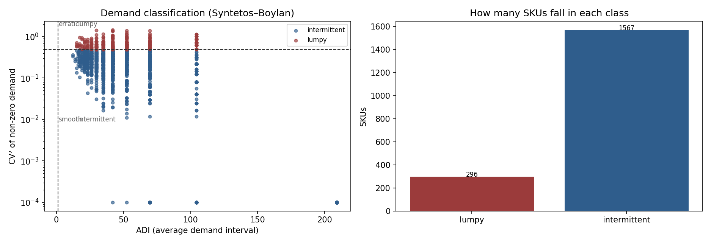
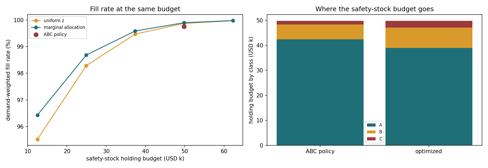

# 供应链库存管理分析

[](https://opensource.org/licenses/MIT) [](https://www.python.org/) [](https://github.com/lingtao-meng/supply-chain-inventory-analysis/actions/workflows/ci.yml)


用 Tableau Superstore 零售数据做库存管理分析：ABC 分类 → EOQ → 安全库存 → 再订货点 → **全 SKU 仿真验证**。

**最重要的结论不是「省了多少钱」，而是「95% 服务水平到底值不值」：**

> 在这份数据（高单价、慢动品）的成本结构下，把服务水平从「不加安全库存」提到 **95%，每年多花 $8,563，只换来填充率从 92% 提升到 98%**。
> 成本-服务前沿显示：缺货成本 $25/单位时，**经济最优服务水平落在 50%**；升到 $100/单位才是 80%，$250 才是 92%，$500 才到 97%。
> 也就是说——**服务水平不是一个"越高越好"的指标，而是由缺货成本算出来的一个经济结论。**

---

## 数据

Tableau Superstore（Kaggle 公开数据），原始 9,994 条交易记录，按产品 ID 聚合成 **200 个 SKU**，覆盖家具、科技产品、办公用品三个品类。

- 年消耗金额合计 **$1,385,577**
- ABC 分类结果：A 类 125 个 SKU（62.5%）占 **79.7%** 金额；B 类 26.5% 占 15.1%；C 类 11.0% 占 5.1%
- 平均单价 $346，年需求量 2–64 件——典型的**高单价、慢动品**结构，这一点决定了后面所有结论

---

## 四个分析模块

- **ABC 分类**：按年消耗金额排序，A 类（前 80%）、B 类（80–95%）、C 类（后 5%）
- **EOQ 分析**：对 A 类算最优订货批量，做订货成本 vs 持有成本率的双因素敏感性分析
- **安全库存**：Z-score 法，算 90% / 95% / 99% 三档服务水平的库存代价
- **再订货点**：`ROP = 日均需求 × 提前期 + 安全库存`

---

## 关键改进：用仿真代替估算

早期版本有两个问题：

1. **仿真太短**：90 天只跑了 2 次补货，样本量根本不够谈缺货率；
2. **成本对比口径混了**：把「盘点频次降低带来的管理成本」算进了「持有成本」——但盘点频次不改变库存水平，也就不会改变持有成本。这一条导致原来"分级管理省 $69K（20%）"的说法站不住。

现在改成：**200 个 SKU × 365 天 × 100 次重复仿真，三个策略共用同一组需求与提前期抽样（common random numbers）**，成本差异不再是随机噪声。

### 策略对比

参数：订货成本 $50/次，持有成本率 25%/年，提前期 lognormal（均值 7 天、CV 30%），单位缺货成本 $25。

| 策略 | 填充率 | 平均库存 | 年持有成本 | 年订货成本 | 年缺货成本 | 年总成本 |
|---|---|---|---|---|---|---|
| 不加安全库存 | 92% | 3.93 | $46,043 | $32,129 | $9,386 | **$87,557** |
| 统一 95% 服务水平 | 98% | 4.77 | $57,778 | $36,399 | $1,944 | $96,120 |
| ABC 分级（99/95/90） | 99% | 5.01 | $62,457 | $37,223 | $1,254 | $100,934 |
| 按单价算出的经济最优 | 92% | 3.98 | $46,355 | $32,287 | $8,755 | **$87,397** |

**怎么读这张表**：在这份数据上，多备安全库存买到的服务水平（+6pp）不值它多花的钱（+$8.5K/年）。这不是说安全库存没用，而是说**这套成本结构下，缺货的代价（$25/单位）小于持有一单位库存一年的代价（$86/单位·年）**。

### 成本-服务前沿

把服务水平从 80% 扫到 99.5%，画持有成本、订货成本、期望缺货成本三条曲线，总成本最低点就是经济最优服务水平。

| 服务水平 | 安全库存（件） | 年持有成本 | 年期望缺货成本 | 年总成本 |
|---|---|---|---|---|
| 50% | 0 | $39,980 | $5,656 | **$85,244（最低）** |
| 80% | 120 | $48,759 | $1,583 | $89,951 |
| 90% | 182 | $53,349 | $671 | $93,628 |
| 95% | 234 | $57,139 | $296 | $97,043 |
| 99.5% | 366 | $66,851 | $22 | $106,481 |

从 50% 到 99.5%，总成本涨了 **25%**，而缺货成本只减少了 $5,634——**持有成本的边际增长远快于缺货损失的边际下降**。

> 完整数字见 `results/service_level_frontier.csv`，图见 `images/cost_service_frontier.png`。

### 最优服务水平由什么决定

唯一的决定性参数是**单位缺货成本**：

| 单位缺货成本 | 经济最优服务水平 | 最优点年成本 |
|---|---|---|
| $10 | 50.0% | $81,851 |
| $25 | 50.0% | $85,244 |
| $50 | 60.0% | $90,313 |
| $100 | 80.0% | $94,699 |
| $250 | 92.0% | $99,387 |
| $500 | 97.0% | $102,503 |

这张表比任何一个单一结论都有用：**当有人说「我们按 95% 服务水平备货」时，正确的问题不是"够不够"，而是"我们的缺货成本是多少"**。

---

## 安全库存公式：补上被忽略的那一项

教材上的安全库存常常写成 `SS = z · σ_d · √L`，隐含**提前期是固定的**。实际上：

```
σ_LT² ≈ L · σ_d² + d̄² · σ_L²
```

第二项 `d̄² · σ_L²` 是提前期波动带来的。对慢动品（d̄ 很小）它未必占主导，但当提前期本身不稳（跨境、供应商延期）时，忽略这一项会系统性低估安全库存。本项目两个版本都算了。

---

## ABC 分级的正确用法

分级管理的价值在**管理成本**（盘点频次、补货作业、盘点人力），不在持有成本：

- A 类：周盘 + 严格 ROP，缺货代价高，值得投入人力
- B 类：双周盘，常规补货
- C 类：月盘 / 双箱系统，缺货影响小

而如果目标是**总成本最低**，应该按「缺货成本 / 单价」而不是按 ABC 分类定服务水平——ABC 是管理强度的分类，不是服务水平的最优解。这是两个常被混为一谈的概念。

---

## 需求分类：不是所有 SKU 都该用指数平滑



用 209 周的周度需求做 Syntetos–Boylan 分类（ADI × CV²）：

| 类别 | SKU 数 | 占比 | 建议方法 |
|---|---|---|---|
| Intermittent（间歇） | 1,567 | 84.1% | Croston / SBA |
| Lumpy（块状） | 296 | 15.9% | 聚合预测 + 人工复核 |
| Smooth / Erratic | 0 | 0% | — |

Top 200 SKU（参与仿真与预算分配的那批）里也是 **170 个 intermittent + 30 个 lumpy**，没有一个 smooth。
这说明：**这套 assortment 的默认预测方法不该是指数平滑/ARIMA，而是间歇需求方法**；
同时，用正态近似算安全库存会偏乐观（下一步应做 lead-time 需求的 empirical bootstrap 或 compound Poisson）。

## 预算约束下的安全库存分配



把安全库存的**持有成本预算**当成约束，比较三种分配：

| 策略 | 预算 | 填充率 | 年缺货成本 | 平均 z |
|---|---|---|---|---|
| ABC（A 99% / B 95% / C 90%） | $49,832 | 99.756% | $644 | 2.03 |
| 统一 z（同预算） | $49,832 | 99.870% | $343 | 2.17 |
| **边际优化**（同预算） | $49,831 | **99.897%** | **$271** | 2.29 |

预算去向（持有成本）：

| 类别 | ABC 策略 | 边际优化 |
|---|---|---|
| A | $42,462 | $38,967 |
| B | $5,849 | $8,103 |
| C | $1,520 | $2,761 |

上一节说 ABC 不是服务水平的最优解，这一节算是把这句话算出来了：
同样预算下，统一 z 的填充率反而比 ABC 高 0.11 个百分点，缺货成本低了 47%；
按边际收益分配再提到 99.897%，同时把约 $3.5k 从 A 类挪到 B/C 类。

预算越紧，优化越值钱：

| 预算占 ABC 预算 | 统一 z 填充率 | 边际优化填充率 |
|---|---|---|
| 25% | 95.52% | **96.43%** |
| 50% | 98.29% | **98.69%** |
| 75% | 99.47% | **99.59%** |
| 100% | 99.87% | **99.90%** |

**假设**：提前期 4 周、订货成本 $50、持有成本率 25%、缺货成本 $50/件、正态需求近似。
这些参数写在脚本里可改；换参数后结论可能变化——所以这是一套**分配方法**，不是一个固定答案。

```bash
python python/demand_classification.py   # ADI/CV² 分类 + 图
python python/inventory_budget.py        # 预算分配 + 前沿 + 图
python python/inventory_budget.py --lead-time 6 --shortage-cost 80
```

---

## 项目结构

```
notebooks/01_abc_analysis.ipynb         ABC 分层与帕累托验证
notebooks/02_eoq_analysis.ipynb         EOQ + 双因素敏感性 + 联合订货 + 业务约束（MOQ/整箱/仓容）
notebooks/03_safety_stock.ipynb         三档服务水平的安全库存
notebooks/04_reorder_point.ipynb        ROP + 库存仿真
python/inventory_simulation.py          ★ 200 SKU × 365 天 × 100 次重复仿真 + 成本-服务前沿
python/demand_classification.py         ADI/CV² 需求分类（Syntetos–Boylan）
python/inventory_budget.py              预算约束下的安全库存分配（ABC / 统一 z / 边际优化）
tests/                                  IE 分析单测
results/                                仿真、分类、预算分配结果
images/cost_service_frontier.png        成本-服务前沿图
images/demand_classification.png        需求分类图
images/inventory_budget.png             预算-填充率前沿与预算去向
```

---

## 运行

```bash
pip install pandas numpy scipy matplotlib jupyter

# 四项基础分析（按 01 → 04 顺序）
cd notebooks && jupyter notebook

# 复现仿真与成本-服务前沿（约 3 秒）
python python/inventory_simulation.py

# 换参数试试
python python/inventory_simulation.py --shortage-cost 250 --reps 200

# 需求分类 + 预算约束分配（先分类，再分配）
python python/demand_classification.py
python python/inventory_budget.py
```

---

## 数据

Tableau Superstore Dataset（Kaggle 公开数据），9,994 条交易，2016 年全年。

## License

MIT
