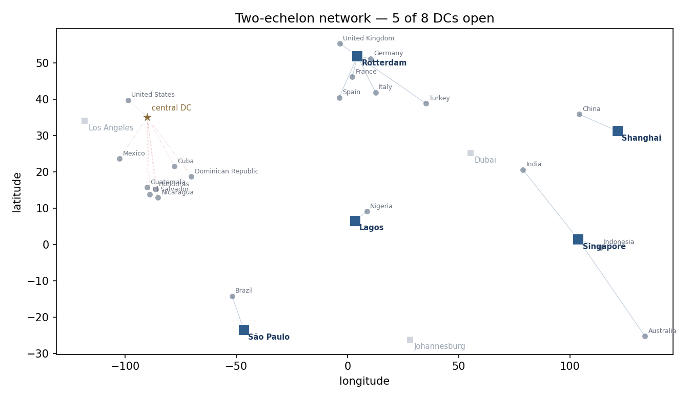
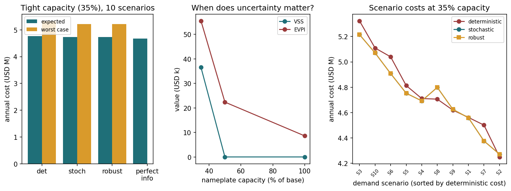

# 两级库存网络优化（MILP）

[](https://opensource.org/licenses/MIT) [](https://www.python.org/) [](https://github.com/lingtao-meng/supply-chain-inventory-analysis/actions/workflows/ci.yml)

用混合整数规划回答一个经典的供应链问题：**中心仓 + 若干区域仓的两级网络，到底该开几个仓、开在哪、谁服务谁？**

**一句话结论**：在基准参数下，优化器从 8 个候选仓里选出 **5 个**，年化成本比「单中心直发」低 **32.1%**，比「8 个仓全开」低 **17.5%**——而且「全开」只比现状好 17.7%，说明**多开仓不是免费的好事**。



---

## 问题定义

- **1 个中心仓**（Memphis，固定，必须使用）
- **8 个候选区域仓**（洛杉矶、鹿特丹、圣保罗、迪拜、新加坡、上海、拉各斯、约翰内斯堡），建不建是要决策的
- **20 个需求区**（DataCo 销量前 20 的国家）
- **5 个品类**（Fan Shop / Apparel / Golf / Footwear / Outdoors）

决策：

1. 开哪些区域仓 `y_d ∈ {0,1}`
2. 每个需求区由谁服务 `x_{c,d} ∈ {0,1}`（**包括"中心仓直发"这个选项**）
3. 每个仓每个品类的安全库存 `SS_{d,f} ≥ 0`

---

## 模型

```
min  Σ_d F_d·y_d                       固定成本
   + Σ_{c,d} r_out·dist(c,d)·V_c·x_cd   支线运输
   + Σ_d r_in·dist(0,d)·W_d             干线运输
   + h·Σ_{d,f} u_f·(R/2·D_df + SS_df)   持有成本（周转 + 安全库存）

s.t. Σ_d x_cd = 1                       每个需求区必须被服务
     x_cd ≤ y_d                          没开的仓不能接活
     Σ_f 52·D_df ≤ cap_d·y_d             吞吐能力
     SS_df ≥ z·CV_f·√L_d·Σ_c μ_cf·x_cd   服务水平约束
```

### 三个建模上的取舍

**1. 必须有"直发"选项，否则结论是假的。**
如果候选设施只有 8 个区域仓，那么"不建区域仓"根本不在可行域里，优化器只能被迫开仓。加一个虚拟仓（固定成本 0、无干线、提前期最长），模型才有资格回答"到底要不要建"。

**2. 安全库存可以线性化，不需要分段。**
按 σ 与需求同比例近似：`σ_LT = CV_f · D_df · √L`，于是服务水平约束变成
`SS_df ≥ z·CV_f·√L·Σ_c μ_cf·x_cd`——关于 x 是线性的，模型保持纯 MILP。
（代价：忽略了需求的绝对波动水平，只用变异系数。对慢动品会低估安全库存。）

**3. 周转库存用"审查周期/2"近似，而不是 EOQ。**
EOQ 里 `Q = √(2DS/h)` 对需求是非线性的，一旦需求变成决策变量就会破坏线性。用"每两周订一次货、平均持有 1 周库存"替代，保持线性且可解释。

---

## 数据

需求、季节波动、单价全部来自 **DataCo 供应链数据集**的真实订单（2015–2017）：

- 需求 = 各国 × 各品类的实际销量
- `CV` = 该品类周度销量的实际变异系数（0.34–0.50）
- 单价 = 该品类销售额 / 销量（$41.7–$145.5）

两个必须说明的处理：

- **规模放大 20 倍**。DataCo 是样本数据（约 8.6 万件/年），直接算出来的结论是"永远别建区域仓"——因为一个仓的固定成本摊不薄。放大到约 179 万件/年（中型零售商量级）后，网络决策才有意义。乘数写在 `data/build_instance.py` 里，可复现、可改。
- **距离用大圆距离，地理中心代替国别质心**。美国用国土中心点，所以"美国本土由中心仓直发"是这个问题设定下的结果，不是现实结论。

---

## 结果

| 方案 | 开仓数 | 固定成本 | 干线 | 支线 | 持有成本 | 年化总成本 | vs 现状 |
|---|---|---|---|---|---|---|---|
| 单中心直发（现状） | 0 | $0 | $0 | $4,784,198 | $1,771,728 | $6,555,926 | — |
| 8 个仓全开 + 就近分配 | 8 | $660,000 | $1,150,778 | $1,955,984 | $1,631,841 | $5,398,602 | 17.7% |
| **MILP 最优** | **5** | **$425,000** | **$936,269** | **$1,397,496** | **$1,695,303** | **$4,454,068** | **32.1%** |

最优解开仓：**鹿特丹、上海、新加坡、拉各斯、圣保罗**。

读法：
- 「全开」比现状省 17.7%，但**多花的固定成本（$660K）几乎吃掉了全部支线节省**——这就是"多开仓不免费"。
- 优化解比「全开」再省 17.5%，靠的是**关掉不划算的仓**（洛杉矶、迪拜、约翰内斯堡），而不是少服务客户。
- 洛杉矶没开、美国需求走中心仓直发：Memphis 到美国国土中心点的距离，和洛杉矶过去的距离差不多——多开一个仓反而多一笔固定成本。

### LP 松弛与最优性 gap

把 0-1 变量放松成连续后求解，目标值 **$4,454,068**，与 MILP 完全相同，**gap = 0.00%**。

这不是 bug：本算例的 LP 松弛恰好取到整数解（`y` 和 `x` 全部是 0/1）。它说明在 20×8 的规模下，连续松弛已经足够紧；规模上去（比如 200 个需求区）才需要依赖 branch-and-bound 的 gap 判断解的质量。

---

## 灵敏度

固定成本是这类模型最敏感的输入——因为它决定"开仓划不划算"的临界点：

| 固定成本系数 | 开仓数 | 年化成本 | vs 现状 |
|---|---|---|---|
| ×0.5 | 6 | $4,229,240 | 35.5% |
| ×1.0 | 5 | $4,454,068 | 32.1% |
| ×1.5 | 3 | $4,615,268 | 29.6% |
| ×2.0 | 3 | $4,752,768 | 27.5% |

服务水平同样会推高成本，但**不改变开仓数**（5 个）：

| 服务水平 | 年化成本 | vs 现状 |
|---|---|---|
| 90% | $4,240,329 | 35.3% |
| 95% | $4,454,068 | 32.1% |
| 99% | $4,855,007 | 25.9% |

结论：**服务水平每提一档，年化成本增加约 $30 万——相当于再开 3 个仓的固定成本**。这是把"服务水平"从口号变成钱的算法。

---

## 随机需求：VSS 与 EVPI

前面的 MILP 用**平均需求**做决策。但开仓和"谁服务谁"必须在需求揭晓前定下来，而需求会波动。
把模型扩展成两阶段随机规划：

- **第一阶段**：开哪些仓 `y`、谁服务谁 `x`（需求未知时决定）；
- **第二阶段**：每个情景下的安全库存（需求已知后调整）；
- **10 个均值保持情景**：每个需求区的期望乘数严格等于 1，所以"平均需求"就是情景的期望；
- **软产能**：超出铭牌产能按 $5/件计加班/应急成本，所有策略在同一成本口径下比较。

三个对照策略：确定性（按平均需求优化）、随机（最小化期望成本）、鲁棒（最小化最坏情景成本）。
两个标准指标：

- **VSS** = 确定性策略的期望成本 − 随机策略的期望成本（忽略不确定性的代价）
- **EVPI** = 随机策略期望成本 − 完美信息成本（更好的需求信息值多少钱）



| 铭牌产能 | 确定性期望 | 随机期望 | 鲁棒期望 | 完美信息 | VSS | EVPI |
|---|---|---|---|---|---|---|
| 100% | $4.454M | $4.454M | $4.490M | $4.445M | $0 (0.00%) | $8,585 (0.19%) |
| 50% | $4.473M | $4.473M | $4.498M | $4.450M | $0 (0.00%) | $22,362 (0.50%) |
| **35%** | **$4.764M** | **$4.727M** | **$4.727M** | $4.672M | **$36,529 (0.77%)** | **$55,493 (1.16%)** |

我自己的理解：

- 产能宽松的时候，按平均需求开仓就是随机最优（VSS=0）。不确定性主要落在安全库存上（EVPI 只有 $8.6K），不影响开几个仓。
- 产能压到 35%，容量约束才开始起作用。随机解和确定性解开出来的仓一样多（6 个），但把英国、意大利、西班牙三个需求区重新分了一遍（英国从直发改走鹿特丹、意大利从鹿特丹改走拉各斯、西班牙从鹿特丹改为直发），VSS 才到 0.77%。
- EVPI 是 1.16%，更好的需求预测一年值 $55K。这也是“预测投入”的上限，别拿它当拍脑袋的 ROI。

> 这张表也修正了上一版的局限 5：基准算例的产能确实过宽，把容量压到 35% 才能看到容量与不确定性的交互。

---

## 局限（先说清楚，比被问出来好）

1. **需求独立同分布**：没有考虑品类之间的相关性，也没有考虑区域仓之间的横向调拨（transshipment）。
2. **安全库存用 CV 比例近似**：对高单价慢动品，绝对波动水平比 CV 更重要，这里会低估安全库存。
3. **单期静态模型**：没有建模建仓的投资分期、关仓的沉没成本。
4. **距离 = 大圆距离**：没有路网、没有关税、没有海运航线约束。
5. **基准算例的容量约束不起作用**：吞吐能力远大于实际流量；随机分析里把产能压到 35% 才让容量约束生效
   （见上一节），真实的容量参数需要仓储调研数据。

---

## 运行

```bash
pip install -r requirements.txt

# 求解（约 3 秒）
python scripts/solve.py

# 换参数
python scripts/solve.py --service-level 0.99 --fixed-mult 1.5

# 随机需求：VSS / EVPI / 鲁棒对照（约 8 秒）
python scripts/stochastic.py
python scripts/stochastic.py --scenarios 12 --sigma 0.4 --capacity-scales 1.0,0.5,0.35

# 重新生成算例（需要 DataCo 原始 CSV）
python data/build_instance.py --dataco ../data/DataCoSupplyChainDataset.csv
```

输出：`results/summary.md`、`results/policy_comparison.csv`、`results/network_solution.csv`、
`results/sensitivity.csv`、`results/stochastic_summary.csv`、`results/stochastic_scenarios.csv`、
`results/stochastic_solutions.csv`、`images/network_map.png`、`images/stochastic.png`。

---

## 项目结构

```
data/build_instance.py    从 DataCo 生成算例（含地理坐标与成本参数）
data/instance.json        已生成的算例（CI 用它，不需要原始 CSV）
src/instance.py           算例加载 + 大圆距离
src/model.py              MILP 建模（PuLP）+ 成本评估
src/stochastic.py         两阶段随机规划 + VSS/EVPI + 鲁棒对照
src/baselines.py          现状（单中心直发）与"全开就近"两个基线
scripts/solve.py          求解 + 对比 + 灵敏度 + 地图 + 报告
scripts/stochastic.py     随机需求分析 + 情景表 + 图表
tests/test_model.py       单元测试（可行性、下界、容量、直发选项）
tests/test_stochastic.py  情景均值保持、VSS/EVPI 非负、鲁棒最坏情况
```

---

## License

MIT
